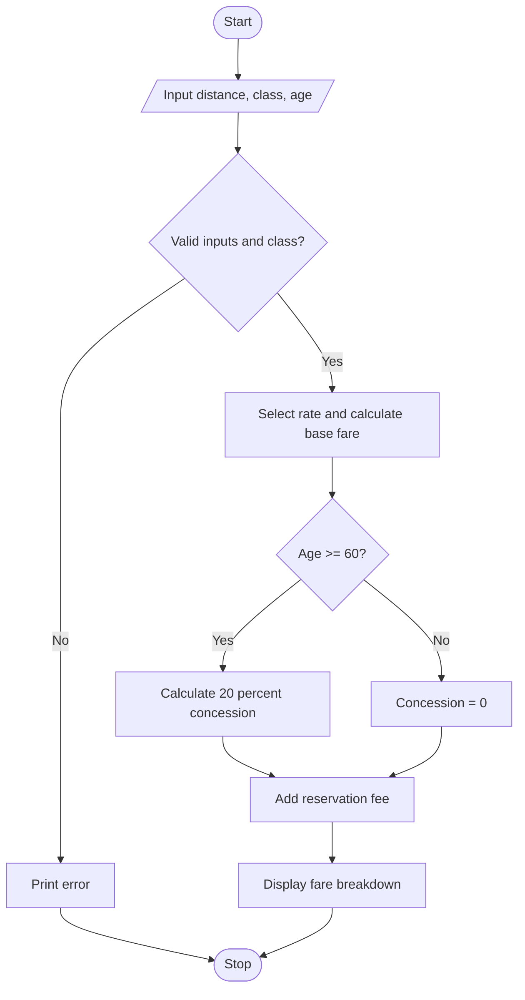

# Case Study 6: Railway Fare and Reservation Calculator

## Problem statement
Calculate a simplified passenger fare from distance and travel class, apply an age-based concession, and add a reservation fee.

## Objectives
- Calculate fare using distance and class rates.
- Apply a concession using a condition.
- Display a fare breakdown.

## Assumptions
- This is an academic example, not an official railway fare calculator.
- Sleeper rate: Rs. 1.20/km; AC rate: Rs. 2.00/km.
- Age 60 or above receives a 20% concession on base fare.
- Reservation fee is Rs. 30.

## Algorithm
1. Input distance, class, and age.
2. Validate inputs and class.
3. Select the class rate and calculate base fare.
4. Apply concession if age is at least 60.
5. Add reservation fee and display the breakdown.

## Flowchart


## Pseudocode
```text
BEGIN
INPUT distance, travel_class, age
IF distance <= 0 OR age < 0: print invalid input
ELSE IF class is not sleeper or ac: print invalid class
ELSE
    choose rate based on class
    base = distance * rate
    IF age >= 60: concession = base * 0.20
    ELSE: concession = 0
    final = base - concession + 30
    print base, concession, fee, final
END
```

## Test cases
| Distance | Class | Age | Expected result |
|---:|---|---:|---|
| 100 | Sleeper | 65 | Base 120; concession 24; final Rs. 126 |
| 100 | AC | 30 | Base 200; no concession; final Rs. 230 |
| 100 | First | 40 | Invalid travel class |

## Output screenshot
Run `main.py` and capture the fare breakdown.

## Conclusion
This program practises input, arithmetic, conditional expressions, and input validation. The rates are illustrative assumptions only.
