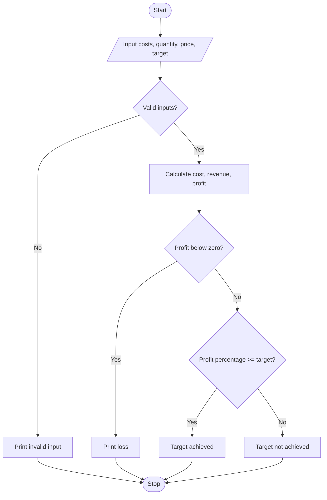

# Case Study 8: Manufacturing Cost and Profitability Analysis

## Problem statement
Calculate total manufacturing cost, sales revenue, profit or loss, and whether the profit target is achieved.

## Objectives
- Add material, labour, and machine costs.
- Calculate sales revenue and profit percentage.
- Classify the result using conditions.

## Assumptions
- Costs, selling price, and target percentage are non-negative.
- Production quantity must be greater than zero.
- Profit percentage is calculated against total cost.

## Algorithm
1. Input costs, quantity, price, and target percentage.
2. Validate the inputs.
3. Calculate total cost and sales revenue.
4. Calculate profit or loss and profit percentage.
5. Display the result and compare it with the target.

## Flowchart


## Pseudocode
```text
BEGIN
INPUT material, labour, machine, quantity, price, target
IF any cost or target is negative OR quantity <= 0
    PRINT invalid input
ELSE
    total_cost = material + labour + machine
    revenue = quantity * price
    profit = revenue - total_cost
    IF total_cost > 0
        profit_percent = profit / total_cost * 100
    ELSE
        profit_percent = 0
    PRINT total_cost, revenue, profit, profit_percent
    IF profit < 0 PRINT Loss
    ELSE IF profit_percent >= target PRINT Target achieved
    ELSE PRINT Target not achieved
END IF
END
```

## Test cases
| Material | Labour | Machine | Qty | Price | Target | Expected result |
|---:|---:|---:|---:|---:|---:|---|
| 1000 | 500 | 500 | 100 | 25 | 10 | Cost Rs. 2000; revenue Rs. 2500; profit 25%; target achieved |
| 1000 | 500 | 500 | 100 | 15 | 10 | Loss of Rs. 500 |
| 100 | 100 | 100 | 10 | 35 | 20 | Profit Rs. 50; 16.67%; target not achieved |

## Output screenshot
Run `main.py` in Python 3 and capture the terminal output.

## Conclusion
This program practises variables, arithmetic operators, input validation, and if-elif-else statements.
