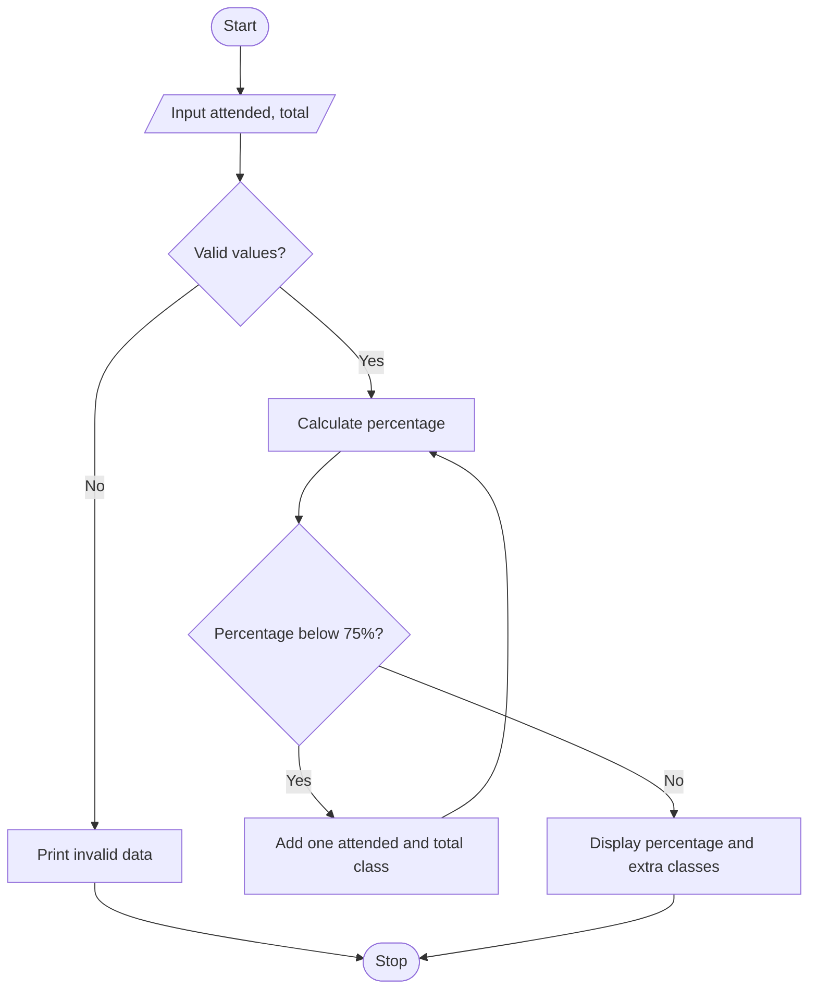

# Case Study 12: Attendance Recovery Computation

## Problem statement
Calculate current attendance percentage and the minimum number of consecutive classes a student must attend to reach 75%.

## Objectives
- Calculate attendance percentage.
- Validate input using conditions.
- Use a `while` loop to find additional classes required.

## Assumptions
- Total classes must be greater than zero.
- Attended classes must be between zero and total classes.
- The student attends every future class. Required threshold: 75%.

## Algorithm
1. Read attended classes and total classes.
2. Validate the values.
3. Calculate attendance percentage.
4. While percentage is below 75%, increase attended and total classes by one.
5. Display current percentage and extra classes needed.

## Flowchart


## Pseudocode
```text
BEGIN
INPUT attended, total
IF total <= 0 OR attended < 0 OR attended > total
    PRINT "Invalid attendance data"
ELSE
    percentage = attended / total * 100
    extra = 0
    WHILE percentage < 75
        attended = attended + 1
        total = total + 1
        extra = extra + 1
        percentage = attended / total * 100
    PRINT percentage and extra
END IF
END
```

## Test cases
| Attended | Total | Expected result |
|---:|---:|---|
| 30 | 40 | Current attendance 75%; requirement already satisfied |
| 20 | 40 | 50%; 20 additional classes; final attendance 75% |
| 0 | 0 | Invalid attendance data |

## Output screenshot
Run `main.py` in Python 3 and capture the terminal output for your report.

## Conclusion
This program practises variables, arithmetic, validation, conditions, and a while loop.
