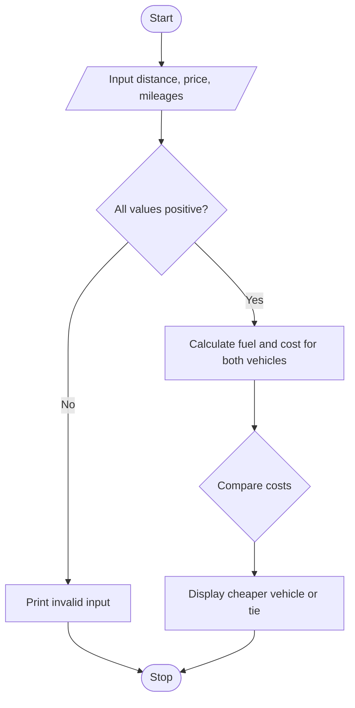

# Case Study 18: Fuel Consumption and Route Comparison

## Problem statement
Compare fuel requirements and journey cost for two vehicles travelling the same distance.

## Objectives
- Calculate fuel required from distance and mileage.
- Calculate cost from fuel usage and price.
- Compare the costs using conditions.

## Assumptions
- Distance, fuel price, and mileage must be positive.
- Both vehicles travel the same distance and use the same fuel price.
- Tolls and maintenance are not included.

## Algorithm
1. Input distance, fuel price, and both vehicle mileages.
2. Check that all values are positive.
3. Calculate fuel required for each vehicle.
4. Calculate fuel cost for each vehicle.
5. Compare costs and display the economical option.

## Flowchart


## Pseudocode
```text
BEGIN
INPUT distance, price, mileage1, mileage2
IF any input <= 0
    PRINT invalid input
ELSE
    fuel1 = distance / mileage1
    fuel2 = distance / mileage2
    cost1 = fuel1 * price
    cost2 = fuel2 * price
    PRINT fuel and cost for both vehicles
    IF cost1 < cost2: vehicle 1 is economical
    ELSE IF cost2 < cost1: vehicle 2 is economical
    ELSE: equal cost
END IF
END
```

## Test cases
| Distance | Fuel price | Mileage 1 | Mileage 2 | Expected result |
|---:|---:|---:|---:|---|
| 300 | 100 | 15 | 20 | Vehicle 1 cost Rs. 2,000; vehicle 2 Rs. 1,500; vehicle 2 economical |
| 100 | 100 | 10 | 10 | Both costs Rs. 1,000; equal cost |
| 100 | 0 | 10 | 20 | Invalid input |

## Output screenshot
Run `main.py` in Python 3 and capture the terminal output for submission.

## Conclusion
This program practises arithmetic, comparisons, conditions, and input validation.
